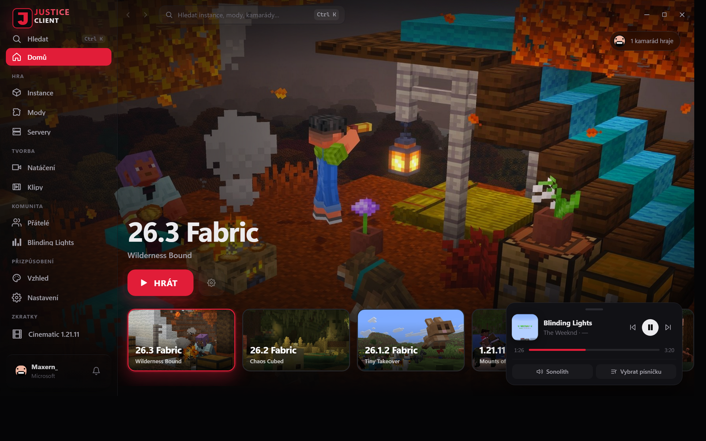
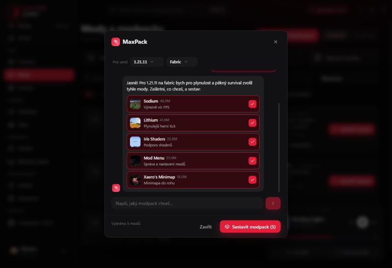
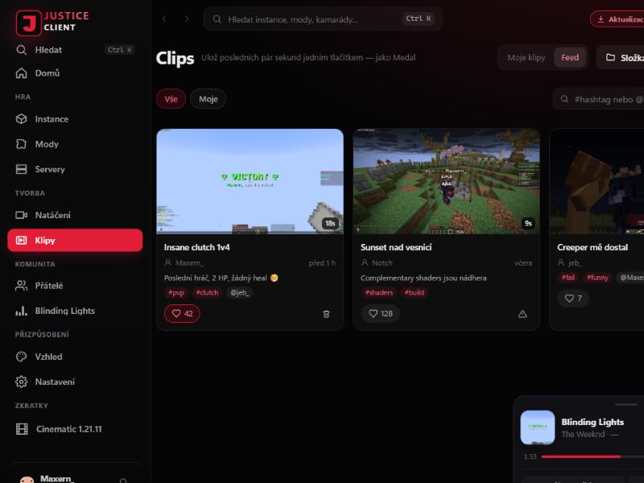

<div align="center">

# Justice Client

**A fast, free Minecraft launcher built for recording and PvP — instances, mods, friends, music and clips in one black‑and‑red app.**

[Download](https://justiceclient.online) · [Website](https://justiceclient.online) · [YouTube @maxernMC](https://www.youtube.com/@maxernMC)



</div>

## Features

- **Instances** — Vanilla, Fabric, Quilt, Forge and NeoForge, any version. Each instance has its own RAM, Java, resolution and folders. One‑click "Play" per version, OneClient‑style.
- **Mods & modpacks** — browse Modrinth and CurseForge, auto‑pick the right version and pull dependencies. Import `.mrpack` and CurseForge packs.
- **MaxPack helper bot** — tell it what you want ("a light performance pack with shaders") and it suggests real, verified Modrinth mods and builds the pack. Free, no API key.
- **Repair wizard** — one pass over duplicates, missing dependencies, version conflicts and the last crash, with a preview and one‑click undo.
- **Download manager** — a CurseForge‑style queue in the top bar with speed, ETA, pause and cancel; the launcher stays usable while packs download in the background.
- **Optimize** — analyses your PC and the instance, then installs performance mods, fixes conflicts and tunes video/Sodium/RAM settings (undoable).
- **Justice Mod** — a Lunar‑style in‑game menu: HUD modules (FPS, CPS, coordinates, speed, keystrokes…), optimizations, clean menus, Now Playing. On Fabric, NeoForge and Forge.
- **Cosmetics** — 28 capes and 12 pets that other Justice Client players see in‑game, plus a skin library to save and switch skins (offline accounts too).
- **Friends & party** — chat, presence, a party you can warp to your server/world, and a friends leaderboard. Offline "Justice" accounts can chat too.
- **Clips** — a Medal‑like replay buffer: press a key to save the last seconds. Trim, add captions and speed, then publish to the Justice feed with hashtags, player tags and likes.
- **Music** — the player reads Windows SMTC / Linux MPRIS, with first‑class support for the Sonolith app; a Now Playing module shows it in‑game.
- **Recording** — OBS scene switching + auto‑record, a cinematic camera mode, and a streamer mode.
- **Crash analyzer** — explains in plain language why the game crashed and points at the suspect mod.
- Java (Temurin) is downloaded automatically in the right version; the game runs with tuned ZGC/G1GC flags.

<div align="center">

 

</div>

## Download

Get the latest build from [justiceclient.online](https://justiceclient.online) — **Windows** (installer), **Linux** (`.deb`, AppImage, Arch package) and **macOS** (universal `.dmg`, unsigned — right‑click → Open the first time).

## Build from source

Requires **Node.js 20+** and **Rust (stable)**. On Windows you also need WebView2; on Linux the WebKitGTK dev packages.

```bash
npm install
npm run tauri dev      # launcher with hot reload
npm run tauri build    # bundles into src-tauri/target/release/bundle
```

Headless self‑test (downloads, launches and closes the game):

```bash
src-tauri/target/debug/justice-client --selftest 1.21.4 fabric cinematic
```

Cross‑platform builds (Windows, Linux, macOS universal) run in GitHub Actions — see [`.github/workflows/build.yml`](.github/workflows/build.yml). Trigger it from the Actions tab or push a `v*` tag.

## Project layout

| Path | What |
|---|---|
| `src/` | Frontend (React + TypeScript, Vite) |
| `src-tauri/` | Backend (Rust, Tauri 2) — launcher, accounts, mods, clips, friends relay |
| `packaging/` | Website, Linux/Arch build scripts, release tooling |

The in‑game mod (Justice Mod) and the friends/clips server (Justice Social) live in their own repositories.

## License

Not yet licensed — all rights reserved for now. Open an issue if you'd like to use part of it.
